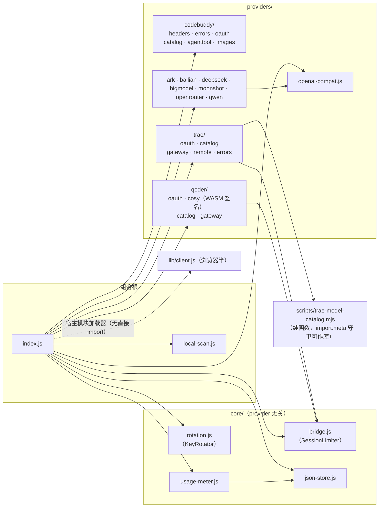

# 09 — 运行方式与测试体系

## 环境要求

- **Node ≥ 22**（纯 ESM，`"type": "module"`）
- 运行时依赖仅两个：`@deepseek-ai/schemastery`（3.18.1）、`yaml`（2.8.0）
- dsh ≥ 0.1.0-rc.7（settings.plugin.item keyed 槽位；rc.6 有兼容写法，见踩坑 #18）；0.8.7 起逐包适配至 **0.1.1-rc.2**（llm-pi-ai 对空 models 清单 apply 即 throw——从 ≤0.8.5 升级须先清理 settings.yaml 里的旧 trae 残块，见 [CHANGELOG](../CHANGELOG.md)）

## 安装与运行

插件是 dsh 的 bundle 包（`package.json` 声明 `dsh.bundle.patch`）；安装进 dsh profile 后由 cordis 加载：

```sh
# 起 dsh 测试服务（默认 3080 端口；插件随宿主启动自动 apply）
dsh web
```

启动后自动发生：

1. patch 生效：`llm-pi-ai` 的 codebuddy/trae 路由、默认模型 deepseek-v3、web 行钉选；
2. `insert` 让 loader 执行 `index.js` 的 `apply()`——注册 web/tools 资源、设置路由、起 :3901 桥；`traeEnabled` 开启时另起 :3902 网关 + 目录同步；
3. CodeBuddy 模型目录从 `/v3/config` 自动同步（失败无感回落静态清单）。

注意：**dsh web 增删插件后必须重启进程**（运行中清单是内存缓存）；WSL 下第二个 dsh 实例（甚至 `dsh web --help`）会抢绑 3901——桥已降级为告警不崩（踩坑 #17）。

## 登录（首次使用）

设置卡路径（dsh ≥ 0.1.6）：侧栏「插件」→ dsh-tap → 展开 **CodeBuddy** 区块 → 「凭据」组
（旧宿主：Settings → 插件配置 → dsh-tap → CodeBuddy 区块）

- **OAuth（推荐）**：浏览器授权一次，覆盖主聊天/搜索/抓取/生图全部路径；
- **API Key**：卡内管理多 Key（≥2 自动轮询），或环境变量 `CODEBUDDY_API_KEY` 兜底。

TraeWork CN / Qoder CN：各自区块的**区块头右侧勾选框**就是启用开关（唯一落点，收起态也能启停）→ 展开区块在「凭据」组登录（Trae 走自持设备密钥的浏览器授权）→ 模型自动进选择器。

## 离线回归（无需网络/凭据，改动后必跑）

| 命令 | 覆盖 | 规模 |
|------|------|------|
| `node scripts/verify-bridge.mjs` | 桥：非流式聚合 / SSE 透传 / 会话头注入与保留 / 会话 FIFO 并发 / 非会话不限流 / agenttool 透传 / 取证日志 / 计量 / developer→system / EADDRINUSE 不崩 | 30 项断言 |
| `node scripts/verify-core-generic.mjs` | core/ 通用性证伪：静态纯净扫描 + 第二 OpenAI 兼容上游全链路（含 developer 角色不被 core 改写的另一半证明） | — |
| `node scripts/verify-rotation.mjs` | 多 Key 轮询（mock 网关按 Key 行为表；`?case=provider/bridge` 双实例隔离） | 25 项断言 |
| `node scripts/verify-providers.mjs` | 多服务商骨架：/models 404 兜底 + 认证方言 | — |
| `node scripts/verify-trae-provider.mjs` | Trae 通道：mock OAuth 全流程（**用我们注册的公钥验 DeviceProof 签名**）/ 目录映射 / 翻译网关 | **89 项断言**（2026-09-23 实测） |
| `node scripts/verify-qoder-provider.mjs` | Qoder CN 通道：mock 设备流全流程（PKCE/404 轮询/drt- 刷新/门禁/代际守卫）+ 翻译网关信封 + 目录投影 + tool 配对/可见性与归因上报锁定案 | **154 项断言**（2026-09-23 实测） |
| `node scripts/verify-host-config.mjs` | 宿主配置层：0.1.7+ forms seam 选路/写前比对/`SETTINGS_CONFLICT` 重试/不可写降级 + ≤0.1.6 settings.yaml 回退 | **36 项断言**（2026-09-23 实测） |
| `node scripts/verify-picker-badge.mjs` | 主界面模型选择器徽标（浏览器半装饰层）：假 `window.__ModuleLoader__` + 假 react/假 DOM/假 fetch 驱动 `apply()`，锁「加载零额外请求 / 上游文案不进 CSS / 陈旧态全清 / 点选择器按需刷新带节流 / trigger 换锚点（`[1b]`） / 排队重试条选数据与 dock 注册」 | **26 项断言**（2026-10-21 实测） |
| `node scripts/verify-client-logic.mjs` | 浏览器半「决策逻辑」（v0.23.0）：假 `window.__ModuleLoader__` + 假 react 驱动，锁网关状态词汇（`off/pending/listening/error` 与旧宿主回退）、状态芯片（含宿主镜像失败）、额度卡退避（30/60/120/300s）、资源包合并保 null、排队重试条的结构化 queueHint，以及宿主/客户端状态词集合一致性与「唯一 fetchWithTimeout」 | **40 项断言**（2026-10-23 实测） |
| `node scripts/verify-net-discipline.mjs` | 上游调用与设置路由的成本/护栏纪律（v0.23.0）：全仓无「裸 fetch」（豁免须注释）、按面超时真的用上、设置路由的 1MiB 上限/413/aborted 收口/幂等响应出口/副作用前置、三个额度快照的 `unauth`、`settingsView` 的 `mirror` 与 `bridge.state` | **25 项断言**（2026-10-23 实测） |
| `node scripts/verify-quota-view.mjs` | 主界面额度卡（v0.22.0）：`core/quota-cache` 的记忆化语义（60s TTL / 15s 强制地板 / 并发单飞 / 失败不缓存）+ `quota-view` 的三通道归一与合计口径（精确/估算/未登录/读失败/非 credit 单位/陈旧）+ 浏览器半 `countTurnTails` 选择器与静态面（槽 id、轮询下限、CSS 只用令牌、`quota-all` 与 config 字段） | **73 项断言**（2026-10-21 实测） |
| `node scripts/verify-desktop-acceptance.mjs` | desktop 适配可执行验收：A 组结构性不变量（§4a index.js 无 desktop 特化 / §4b 宿主差异收口 / §6 goal 锚点；`--structural` 为 CI 硬闸门）+ B 组桌面环境断言（有 `~/.dsh/profiles/desktop` 才跑）；C 组活实例断言恒 SKIP，由端到端探针承担（证据 docs/probes/desktop-e2e-2026-10-03.json） | **9 ok / 0 FAIL / 3 SKIP**（2026-10-03 实测） |
| `node scripts/verify-gateway-core.mjs` | 本机面的「唯一实现」闸门（v0.24.0）：`core/net-guard` 判定矩阵（Host 带端口/裸 `::1`/无 Origin/`Origin: null`/allowedOrigins 精确匹配）+ `core/http-surface` 服务器行为（403 排空→JSON、413 先排空再应答、404、同步/异步抛错→500、`stop()`、`port:0` 回填、EADDRINUSE 不崩、OpenAI 路由形状）+ `describeError` 契约 + `createChannelRuntime` 五语义 + 静态唯一性（门/脚手架/响应出口/客户端格式化器） | **67 项断言**（2026-10-21 实测） |
| `node scripts/verify-host-split.mjs` | 组合根拆分后的结构验收（v0.25.0）：index ≤1200 / route ≤120 行、`host/**` 模块登记表、依赖单向（models 不 import settings、providers 不 import models/settings、core 不 import host）、28 action 齐全、动作体不自己拼响应、模块头注释 | **41 项断言**（2026-10-21 实测） |
| `node scripts/verify-pack.mjs` | 发布完整性（v0.25.0）：`package.json#files` 覆盖 `host/**`、`core/**`、`providers/**` 与必需文件；`main`/`exports`/`dsh.bundle.patch` 都指向存在的文件；说明类文件在发布清单内 | **56 项断言**（2026-10-21 实测） |
| `node scripts/verify-channel-contract.mjs` | 通道扩展点四方对账（v0.26.0）：契约形状（必填/可选/未知字段/重复 id）+ 三条真实通道的 settings 键与 runtime 台账 + 组合根按清单迭代（无通道名字面量）+ 客户端区块/control 对账 + quota-view 清单形态与命名形态同形 | **45 项断言**（2026-10-21 实测） |
| `node scripts/verify-all.mjs` | 聚合入口：自动发现全部离线套件（`--list` 只列、`--only=` 过滤） | — |
| `node scripts/verify-agents-md.mjs` | AGENTS.md 预算闸门：行数/字节/引用路径存在 + 踩坑编号连续性对账 | — |
| `node scripts/verify-models.mjs` | 模型解析离线自检 / 在线探测可用性 / 目录漂移对比 | — |
| `node scripts/verify-trae-model-catalog.mjs` | 目录提取器回归 | — |

**`npm run verify` = 全部离线回归**（v0.24.0 起）：`scripts/verify-all.mjs` **自动发现** `scripts/` 下的 `verify-` 套件并按文件名顺序执行（`verify-models --list` / `verify-desktop-acceptance --structural` 的默认参数内置），逐套计时、失败贴全文、任一失败非零退出。新增套件**零登记**——写进 `scripts/` 就自动进闸门（此前手写 CI step 清单漏过 `verify-trae-model-catalog` 两个版本）。

**`npm run verify:live` = 在线模型探测**（18 次真实请求，消耗额度，CI 与离线闸门都不跑）。单套快捷方式仍保留：`verify:bridge` / `verify:core` / `verify:providers` / `verify:trae` / `verify:trae-provider` / `verify:qoder` / `verify:host-config` / `verify:picker-badge` / `verify:client` / `verify:gateway` / `verify:net` / `verify:quota`。

**断言纪律**：验证队列/代理行为必须断言"响应完成"（EOF），不是首字节；跨层测试先想清楚轮转游标在第几个请求上。

## 在线探测/取证脚本（会消耗额度，按需使用）

| 脚本 | 用途 |
|------|------|
| `verify-models.mjs --sync` | 对比 `/v3/config` 目录漂移 |
| `verify-models.mjs --efforts [id…]` | 探测 reasoning_effort 档位 |
| `probe-ua.mjs` | UA 门矩阵探测（74 条证据可复跑） |
| `probe-oauth.mjs` | OAuth 设备流探测 |
| `probe-quota.mjs` | 额度信号探测（accounts/dosage-notify/资源包） |
| `probe-media.mjs` | 生图/视频/3D 端点探测 |
| `probe-routing.mjs` / `probe-moderation.mjs` | 路由与审核面 |
| `probe-codebuddy-channel.mjs [--out <证据.json>]` | 渠道校验 system 指纹判据：A 原样 11128 / B 改写 200 / C 放 user 200 / D 无句号 11128（2026-10-21，证据默认落 docs/probes/codebuddy-channel-<date>.json） |
| `probe-cache.mjs` / `probe-cache-ttl.mjs` / `capture-cache.mjs` | 网关缓存对照（--model/--arms/--repeat/--calls） |
| `capture-traffic.mjs` | 受控主聊天流量（多轮/重发/子代理，经 3080 RPC） |
| `measure-latency.mjs --mock\|--real` | 识图/搜索端到端延迟分布（JSONL 落盘） |
| `probe-trae-live.mjs --login` / `--chat "文本"` | Trae 真实登录（一次性）与对话联调（证据落 docs/probes/ 校准信封） |
| `probe-qoder-live.mjs --login` / `--chat "文本"` | Qoder CN 真实设备流登录 / 真实对话（cosy 签名路径，证据落 docs/probes/） |
| `probe-codebuddy-efforts.mjs [--catalog] [--models a,b] [--repeat N] [--summarize <证据.json>]` | CodeBuddy 思考强度现状探测 + 档位表决策表（证据落 docs/probes/codebuddy-efforts-*.json） |
| `probe-codebuddy-tier-wiring.mjs` | 【真实上游】档位全链路联调：目录声明→档位表→镜像→桥出站注入（经本地捕获代理，临时 DSH_HOME 隔离） |
| `probe-qoder-null-content.mjs [--models dmodel,kmodel] [--gw-local]` | content 可见性单变量差分（provider_error 真根因判别；--gw-local 用当前代码起临时网关做前后对比） |
| `probe-qoder-pairing.mjs [--live] [--model dmodel]` | 宿主真实序列化器离线复现 tool 配对/可见性坏体 + 真实上游重放 |
| `probe-qoder-matrix.mjs --suite flash\|tools\|reject\|repair` | Qoder 差分矩阵（逐变量隔离上游报错，证据 docs/probes/qoder-matrix-*.json） |
| `probe-qoder-flash-confirm.mjs` | Qwen3.8-Flash 上游节点状态确认（3×Flash + 2×对照，恢复即翻绿） |
| `probe-qoder-thinking-config.mjs` | 【只读】Qoder 目录逐模型 `thinking_config` → `reasoningEfforts` 档位表投影（一次签名 GET，无聊天请求；证据 docs/probes/qoder-thinking-config-*.json） |
| `probe-qoder-thinking-efforts.mjs [--models a,b] [--repeat N] [--endpoint http://127.0.0.1:3913/v1]` | 【真实上游】Qoder 档位效果定论：显式 `reasoning_effort` 逐声明档位开臂（避 prefs 注入污染），每臂 N 采样聚合 min/mean/max，非单调即 INCONCLUSIVE（#42）；总额度硬闸 30 次（证据 docs/probes/qoder-efforts-*.json）——2026-10-04 结论：2 模型同向非单调（高档位均值反而更低），档位入口不报错 ≠ 有单调语义 |
| `probe-qoder-quota.mjs [--read-only]` | 用量计数器差分（quota/heatmap/summary 前后对比，--read-only 只读） |
| `probe-qoder-attribution.mjs [--arm N]` | 用量归因梯度实验（裸体/信封/business块/finish/tracking 逐臂判定） |
| `probe-trae-model-routing.mjs --round 2\|evidence\|3\|4` / `probe-trae-3003-diagnosis.mjs` | Trae 模型改派矩阵（四轮合并，轮次对应原 model-routing/routing-evidence/routing3/routing4） / 3003 故障定位取证 |
| `probe-trae-efforts.mjs [--model id] [--levels light,high,extra_high] [--repeat N]` | 【真实上游】Trae inline 面 `reasoning_effort` 方言判定（多臂多采样，证据 docs/probes/trae-efforts-*.json）——2026-10-04 终局：inline_chat 面 thinking 由 scene 钉死 disabled、客户端字段无法翻转（`probe-trae-thinking-scene.mjs` 三变体复证）⇒ inline 面永不携带档位，出档走 remote 面 |
| `probe-trae-thinking-scene.mjs [--model glm-5.3] [--repeat N] [--skip-p2]` | 【真实上游】G3 门控探针：P1 = remote 通道 `custom_model.reasoning_effort` 多臂多采样（官方 bundle 取证的线缆字段；2026-10-04 实测 8/8 臂 200 被接受、真模型路由确认、效果方向性 INCONCLUSIVE/high 单向）；P2 = raw 面 scene/字段枚举单发（inline 三变体终局 3003 实录）——证据 docs/probes/trae-thinking-scene-*.json |
| `probe-trae-max-effort.mjs [--model id] [--effort max] [--base url]` | 【真实上游】Trae remote 面 `max` 档判定：max/extra_high/high 三臂推理量对照（2026-10-05 glm-5.3 = 2788 < 3209 < 4139 推理字符，方向一致，max 是真实独立档位非假档位）⇒ 投影对声明了 extra_high 的模型追加 max 上位档（目录不声明但上游实测接受）——证据 docs/probes/trae-max-effort-*.json |
| `probe-ark-thinking.mjs [--full-matrix] [--levels-as-arms] [--models a,b] [--levels …] [--repeat N] [--emit yaml] [--write <patch.yml>] [--from <证据.json>]` | 【真实上游·只读】Ark `/api/plan` 逐模型思考面实测 → 产出 `reasoningEfforts` 声明：**默认省额度两臂**（baseline+enabled；off 视为未测不臆造，`--write` 保留 patch 既有 off 档），`--full-matrix` 才跑旧三臂全矩阵（baseline/enabled/disabled，可证 off）；`--levels-as-arms` 每声明档位各开一臂（budget=pi-ai 映射 low 2048/medium 8192/high 16384/max 16384、max_tokens=32768=宿主线值），定论「档位是否单调」用；`--repeat N` 每臂 N 次聚合 min/mean/max；`--emit` 打印、`--write` 直接写 profile patch（留 `.bak`）、`--from` 复用既有证据不打上游。新 Ark 模型进选择器 = 先省额度跑这条，要 off 结论再加 `--full-matrix`，要档位语义结论加 `--levels-as-arms`（证据 docs/probes/ark-thinking-*.json）——2026-10-04 档位臂结论：3/3 非单调记 INCONCLUSIVE，high/max 同线值对照噪声 2.5 倍 ⇒ 档位=budget 上限非旋钮 |
| `probe-effort-gaps.mjs [--url …] [--token <web token>] [--patch <cordis.patch.yml>]` | **免凭据**缺口检测：插件侧声明（`model-list` / `qoder.models.efforts` / `trae.models.efforts`）× 路由条目实况（宿主配置层）三层对账，报「声明了却没到条目」与「缺 compat」；只对账**已启用**模型（停用项不算缺口）；Trae 侧镜像键是宿主枚举映射（light→low/extra_high→xhigh），与声明拼写不同属预期形态。发版前跑一次（踩坑 #64 的回归眼；带 token 闸的实例用 `--token`） |
| `trae-model-catalog.mjs` | Trae 目录提取 CLI（纯函数可作库导入，import.meta 守卫） |
| `hermes-probe-dev-role.mjs --round 1\|2\|3` | developer 角色事件取证（三轮合并，轮次对应原 -role/-role2/-role3） |

**取证开启方式**：

```sh
CODEBUDDY_BRIDGE_LOG=/tmp/bridge.jsonl dsh web   # 请求哈希/头特征/usage（不落明文）
CODEBUDDY_BRIDGE_DUMP=/tmp/dump dsh web           # 叠加请求体明文（仅本地诊断，慎开）
```

## 探针频率纪律（防风控封禁，2026-10-21 起）

上游（尤其 CodeBuddy CN 站）对「非常规客户端 / 高频请求」有**账号级**风控：一旦命中，聊天面全模型回 `403/11140`（「账号存在异常行为，已被限制使用」），而目录面 `/v3/config` 仍 200——设置卡「测试一下」照常显示正常，极易误判成密钥问题（诊断全本 [diagnosis-codebuddy-11140](../docs/diagnosis-codebuddy-11140.md)，踩坑 #73）。在线探测按下面纪律执行：

- **串行**：同一上游的 4xx 语义探测不并发；两次请求间隔 **≥20s**（与 Trae 4011 的 20s 纪律同源）。
- **单轮 ≤3 发**：一轮探测（判定一个假设）最多 3 发，打完就停，不「再跑一遍确认」；命中拒绝即停手记录（code / msg / requestId）。
- **只探目标面**：验证聊天可用性必须打 chat completions；目录 / 账户面 200 不能推出聊天面可用。
- **封禁期零请求**：看到 11140 就停掉一切上游调用（含设置卡同步、模型测试、探针），先带 `requestId` 申诉或等待；重登 / 刷新令牌 / 重装均无效。
- **真实 payload 回放只做「一次定位」**：它能复现 11128 这类内容面判据，但也是风控眼里的异常流量——打通即停，不要集群重放。

## 浏览器回归（UI 改动后）

脚本位于**仓库外**本地目录 `dsh-ui-test/`（puppeteer-core + 系统 Chrome，不进仓库）。**套件清单、断言基线、区块驱动口径、实例与 token、零真实写入纪律的唯一真源 = 项目 skill `.agents/skills/dsh-ui-regression/`**（跑 UI 回归前先加载它）；断言数沿革见 [CHANGELOG](../CHANGELOG.md)（0.10.0 手风琴换代 `card-accordion.js` 为唯一设置卡套件，详见 [07](07-web-client.md)）。

跑法骨架：`node <脚本>.js "http://127.0.0.1:<port>/?token=..."`（0.1.5 起 web 入口要 token，踩坑 #30；测试服务由用户侧 launcher 托管在 :3090，**回归轮次不启停它、不占端口**；profile 已 link 本仓库 ⇒ 改 `lib/client.js` 刷新即生效，建议 `--disable-http-cache`）；零真实写入 = 跑前跑后对 `~/.dsh/codebuddy-plugin.json` 取 md5 对账。

## 依赖关系图（模块级）



外部依赖：Node 内建（fs/os/path/http/crypto/url）+ `yaml` + `@deepseek-ai/schemastery`；宿主服务经 `ctx.inject`（web / webServer / tools / settings）。**插件不能 import `@deepseek-ai/*` 运行时包**（加载器按插件路径解析——踩坑 #9），provider 接口用鸭子类型零依赖实现。

## 故障速查

| 症状 | 优先检查 |
|------|----------|
| 主聊天 503 "credential unavailable" | 设置卡登录区（apiKeys 空 / OAuth 过期） |
| 主聊天全挂 content_filter | 桥的 developer→system 重写是否被绕过（verify-bridge §9） |
| 主聊天连接失败 | bridgePort 与 patch baseURL 是否一致；`bridgeRuntime.lastError`（设置卡桥分区） |
| 设置卡模型勾了但选择器没有 | CodeBuddy：settings.yaml 镜像是否写入（`syncModelsToDshSettings`）；Trae/Qoder：`providers.trae`/`providers.qoder` 整块是否存在（禁用/未同步 = 删块属正常语义） |
| trae 3003 | 服务端 inline 面故障（非凭据问题）——切 remote 传输或等自愈 |
| qoder 聊天 503 `qoder_credential_unavailable` | 设置卡 Qoder CN 区先完成浏览器授权（令牌临期自动刷新；refresh 失败会置"需重新登录"） |
| 添加服务商后整个用户层 provider 消失 | settings.yaml 坏块连坐（踩坑 #21）——检查手动写入的块 |
